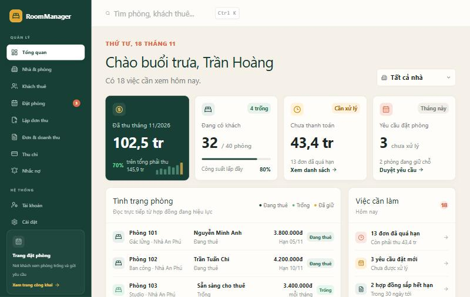
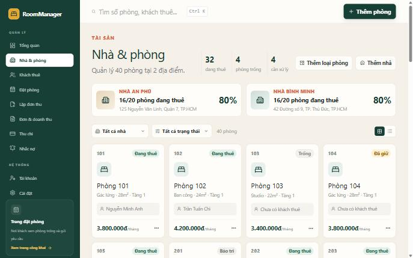
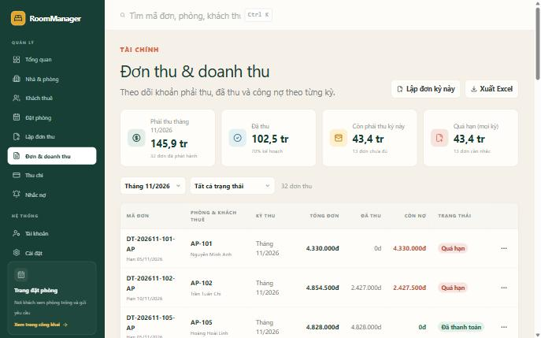
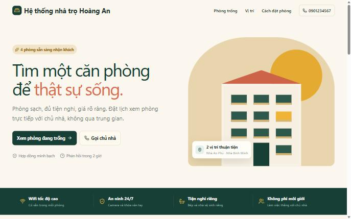

# RoomManager

[](https://github.com/2ez4gcx/RoomManager/actions/workflows/ci.yml)
[](LICENSE)


Phần mềm quản lý nhà trọ mã nguồn mở: phòng, khách thuê, hợp đồng, đơn thu điện nước, công nợ, sổ thu chi và trang đặt phòng online. Chạy miễn phí trên một máy tính Windows hoặc trên Cloudflare Workers.

*Open-source rental-room management for small Vietnamese landlords. The interface and documentation are in Vietnamese.*

> [!WARNING]
> **Bản thử nghiệm (0.1.0).** Phần mềm có bộ kiểm thử tự động nhưng chưa được dùng lâu dài với một nhà trọ thật. Hãy chạy thử bằng dữ liệu mẫu trước, và đối chiếu song song với sổ sách cũ ít nhất một kỳ thu trước khi tin vào con số. Xem [Trách nhiệm khi sử dụng](#trách-nhiệm-khi-sử-dụng).



| Nhà & phòng | Đơn thu | Trang đặt phòng công khai |
|---|---|---|
|  |  |  |

## Tính năng

- **Nhà & phòng** — nhiều nhà trong một hệ thống; trạng thái phòng (đang thuê, trống, đã giữ, bảo trì) được suy ra từ hợp đồng và giữ chỗ, không phải tự đánh dấu.
- **Khách thuê & hợp đồng** — tạo hồ sơ và hợp đồng cùng lúc, sửa giá thuê và thời hạn, theo dõi công nợ, trả phòng kèm chốt tháng cuối và tất toán tiền cọc.
- **Lập đơn thu theo kỳ** — nhập chỉ số điện từng phòng, xem tiền tính lại ngay, phát hành đơn cho mọi phòng trong một lượt. Tiền phòng tự chia theo ngày cho khách vào hoặc ra giữa tháng.
- **Thu tiền & công nợ** — ghi nhận thanh toán một phần hoặc toàn phần, hủy đơn lập nhầm rồi lập lại, lọc theo kỳ.
- **Sổ thu chi** — thu chi vận hành tách khỏi tiền cọc, biểu đồ 6 tháng, cơ cấu chi.
- **Nhắc nợ** — mỗi sáng tự rà đơn sắp đến hạn, đến hạn, quá hạn và soạn sẵn tin nhắn để gửi qua Zalo hoặc gọi điện.
- **Xuất Excel** — danh sách khách thuê, đơn thu theo kỳ, sổ thu chi; cột tiền và cột ngày là số và ngày thật.
- **Trang đặt phòng công khai** — hiện phòng còn trống, khách gửi yêu cầu xem phòng; chủ nhà duyệt trên bảng kanban.
- **Tài khoản & phân quyền** — chủ nhà và nhân viên; nhân viên vận hành hằng ngày nhưng không hủy đơn, không đổi giá, không quản lý tài khoản.
- **Bảo mật** — mật khẩu băm PBKDF2, phiên lưu cookie `HttpOnly`, giới hạn số lần nhập sai, xác thực hai bước (TOTP) kèm mã khôi phục, nhật ký thao tác.

## Xem thử

Cần [Node.js](https://nodejs.org) 22.18 trở lên.

**Windows:** tải mã nguồn về, nhấp đúp `start.bat`. File này tự cài thư viện, khởi động, nạp dữ liệu mẫu rồi mở trình duyệt.

**Thủ công:**

```bash
npm install
npm run dev
npm run db:setup
```

Mở <http://localhost:3000> và đăng nhập bằng tài khoản mẫu `quanly@example.com` / `roommanager`. Dữ liệu mẫu gồm 2 nhà, 40 phòng, 32 hợp đồng và 32 đơn thu; mọi tên và số điện thoại trong đó đều là giả.

> [!CAUTION]
> Chế độ xem thử chỉ để xem thử. Tài khoản mẫu có mật khẩu công khai, và ở chế độ này ai vào được máy cũng xóa được dữ liệu. Đừng nhập dữ liệu thật vào đây.

## Dùng với dữ liệu thật

Có hai cách, khác nhau ở chỗ dữ liệu nằm đâu:

| | Trên một máy tính | Trên Cloudflare |
|---|---|---|
| Truy cập từ | Máy đó và thiết bị cùng wifi | Bất kỳ đâu có mạng |
| Dữ liệu nằm ở | Ổ cứng máy đó | Cloudflare D1 |
| Sao lưu | Tự chép thư mục dữ liệu | Time Travel của D1 |
| Chi phí | 0đ | 0đ với quy mô nhỏ (gói Free) |
| Bắt đầu | `khoi-tao-that.bat` rồi `chay-server.bat` | [Hướng dẫn deploy](docs/DEPLOY-CLOUDFLARE.md) |

- **Người không rành kỹ thuật:** làm theo [Hướng dẫn cài đặt](docs/HUONG-DAN-CAI-DAT.md), từng bước một.
- **Người quen dòng lệnh:** xem [Vận hành](docs/VAN-HANH.md) — chạy server, khởi tạo, cập nhật, sao lưu, chạy sau proxy HTTPS, cứu mật khẩu.

## Công nghệ

- [React 19](https://react.dev) với [vinext](https://github.com/cloudflare/vinext) (App Router chạy trên Vite)
- [Cloudflare Workers](https://developers.cloudflare.com/workers/) và [D1](https://developers.cloudflare.com/d1/) (SQLite); bản chạy trên máy dùng [Miniflare](https://miniflare.dev) với đúng runtime đó
- [Drizzle ORM](https://orm.drizzle.team) và migration SQL trong `drizzle/`
- TypeScript, ESLint, bộ kiểm thử chạy bằng `node:test`

Không phụ thuộc dịch vụ trả phí nào. File Excel, mã QR và TOTP được viết trong mã nguồn, không dùng thư viện ngoài lúc chạy.

## Phát triển

```bash
npm test        # typecheck, build, rồi hơn 150 bài kiểm thử trên workerd + D1 thật
npm run lint
```

Mọi push và pull request vào `main` chạy lại đúng các lệnh này trên GitHub Actions, kèm rà soát phụ thuộc và kiểm tra cấu hình nguy hiểm.

| Thư mục | Vai trò |
|---|---|
| `app/` | Trang, client component và API route (`app/api/`) |
| `db/` | Schema Drizzle, truy vấn, nghiệp vụ (lập đơn, thu tiền, trả phòng, nhắc nợ) và xác thực |
| `drizzle/` | Migration SQL |
| `worker/` | Điểm vào của Worker và cron nhắc nợ |
| `scripts/` | Chạy server trên máy, khởi tạo, kiểm tra sau deploy |
| `tests/` | Kiểm thử tích hợp trên bản build |
| `docs/` | Tài liệu |

Muốn đóng góp, xem [CONTRIBUTING.md](CONTRIBUTING.md). Thay đổi qua từng phiên bản ghi ở [CHANGELOG.md](CHANGELOG.md).

## Tài liệu

| Tài liệu | Dành cho |
|---|---|
| [Hướng dẫn cài đặt](docs/HUONG-DAN-CAI-DAT.md) | Người dùng tự cài, không cần biết lập trình |
| [Vận hành](docs/VAN-HANH.md) | Người trông coi một bản đang chạy |
| [Đưa lên Cloudflare](docs/DEPLOY-CLOUDFLARE.md) | Deploy lên Workers + D1 |
| [Mô hình dữ liệu](docs/DATA-MODEL.md) | Người đọc và sửa mã |
| [Định hướng sản phẩm](docs/PRODUCT-SCOPE.md) | Phạm vi và lý do thiết kế |
| [Đóng gói và bàn giao](docs/BAN-GIAO.md) | Người cài hộ cho chủ trọ khác |
| [Triển khai trên VPS](docs/DEPLOYMENT.md) | Phác thảo phương án PostgreSQL, chưa thực hiện |

## Giới hạn hiện tại

- **Chưa tự gửi tin nhắc nợ.** Hệ thống soạn sẵn nội dung; việc gửi qua Zalo, SMS hay email cần tài khoản dịch vụ riêng nên chưa tích hợp.
- **Không gửi email.** Quên mật khẩu được xử lý bằng link do chủ nhà cấp.
- **Một tổ chức mỗi bản cài.** Nhiều nhà thì được, nhiều chủ trọ độc lập thì mỗi người một bản.
- **Bản chạy trên máy không có HTTPS** trừ khi đặt sau một reverse proxy.
- **Đường deploy lên Cloudflare** đã được kiểm ở máy với Miniflare nhưng chưa được tác giả chạy trên một tài khoản Cloudflare thật.

## Trách nhiệm khi sử dụng

Phần mềm được chia sẻ nguyên trạng, **không kèm bảo hành nào** (xem giấy phép). Trước khi nhập dữ liệu thật, cần biết:

- **Bạn là người chịu trách nhiệm về dữ liệu cá nhân của khách thuê** (họ tên, số điện thoại, số CCCD, công nợ) theo quy định về bảo vệ dữ liệu cá nhân của Việt Nam: chỉ thu thập khi khách đồng ý, giới hạn người được xem, xóa khi không còn cần, và tự lo sao lưu.
- **Đây là sổ theo dõi, không phải phần mềm kế toán**, không xuất hóa đơn điện tử, không khai thuế, không đăng ký tạm trú. Phần mềm không đụng tới tiền thật: nó chỉ ghi lại con số bạn nhập.
- **Luôn đối chiếu con số** với sổ sách của bạn, nhất là tiền điện nước và tiền cọc. Tác giả không chịu trách nhiệm về mất dữ liệu hay số liệu sai.
- **Chế độ mạng nội bộ không có HTTPS**: mật khẩu đi qua wifi ở dạng chữ thường. Chỉ dùng trong mạng bạn tin tưởng.
- Tài khoản mẫu `quanly@example.com` / `roommanager` có mật khẩu công khai. Không bao giờ để nó tồn tại trên bản chạy với dữ liệu thật.

## Đóng góp và báo lỗi

- Lỗi và đề xuất: mở [issue](https://github.com/2ez4gcx/RoomManager/issues).
- Lỗ hổng bảo mật: **đừng mở issue công khai**, xem [SECURITY.md](SECURITY.md).
- Sửa mã: xem [CONTRIBUTING.md](CONTRIBUTING.md).

## Giấy phép

[MIT](LICENSE). Dùng, sửa và phân phối lại tự do, không kèm bảo hành.
